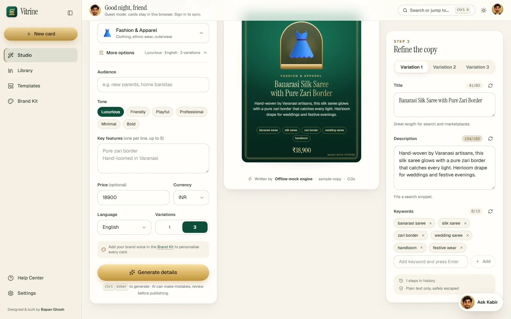
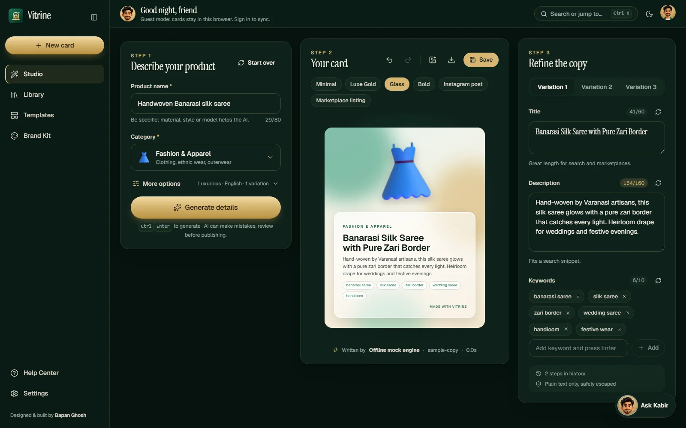
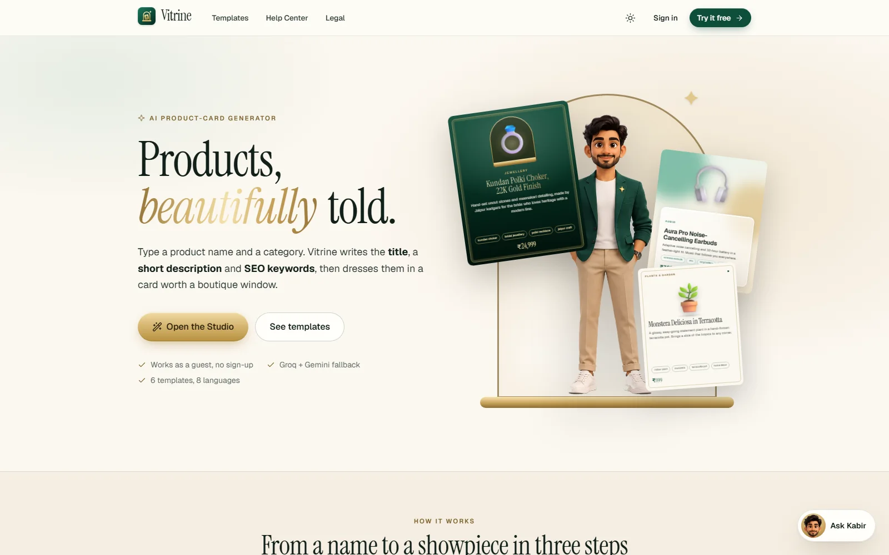
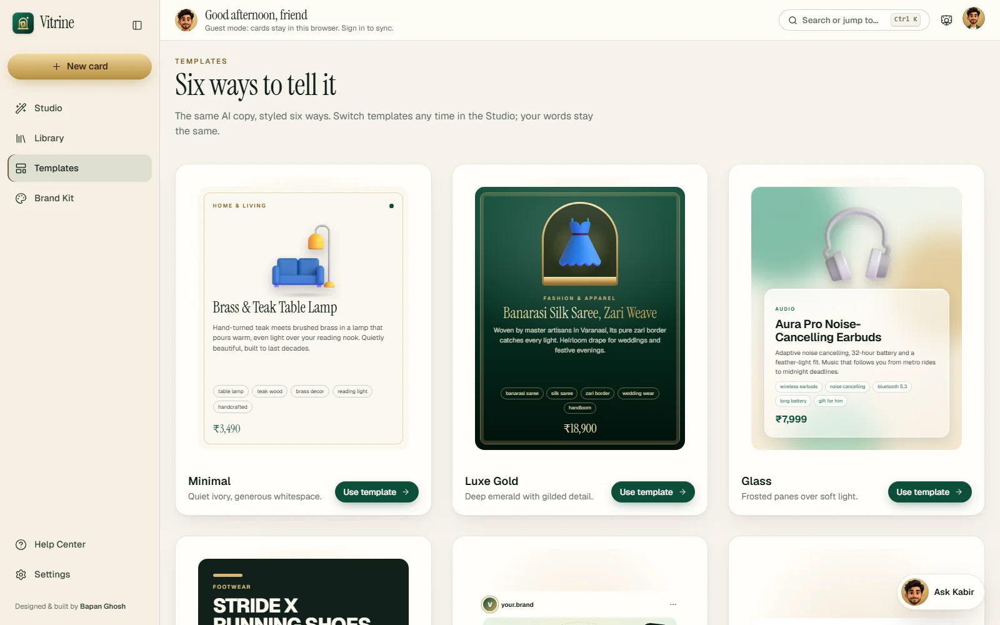
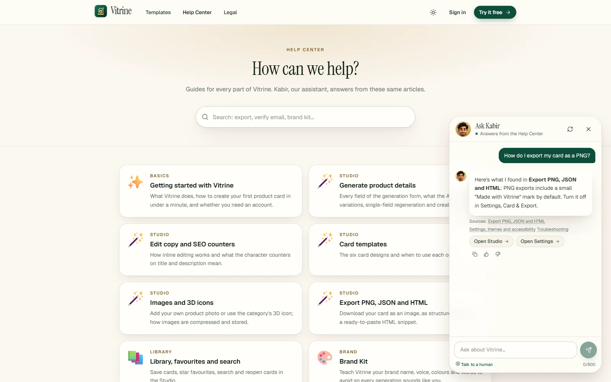
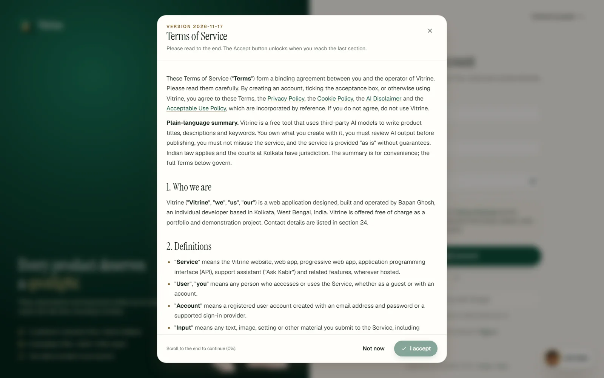
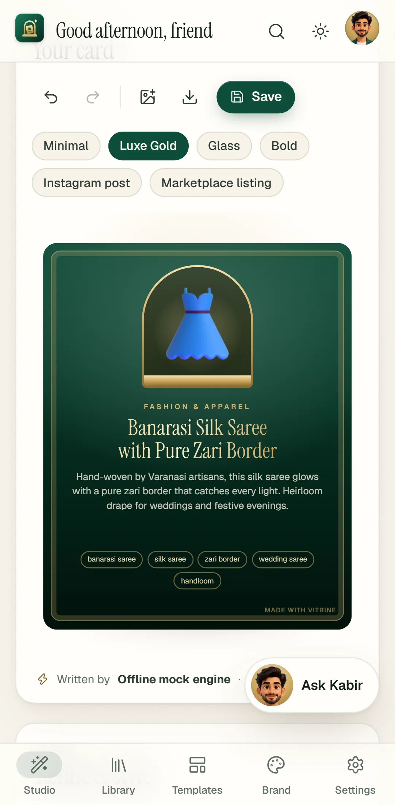
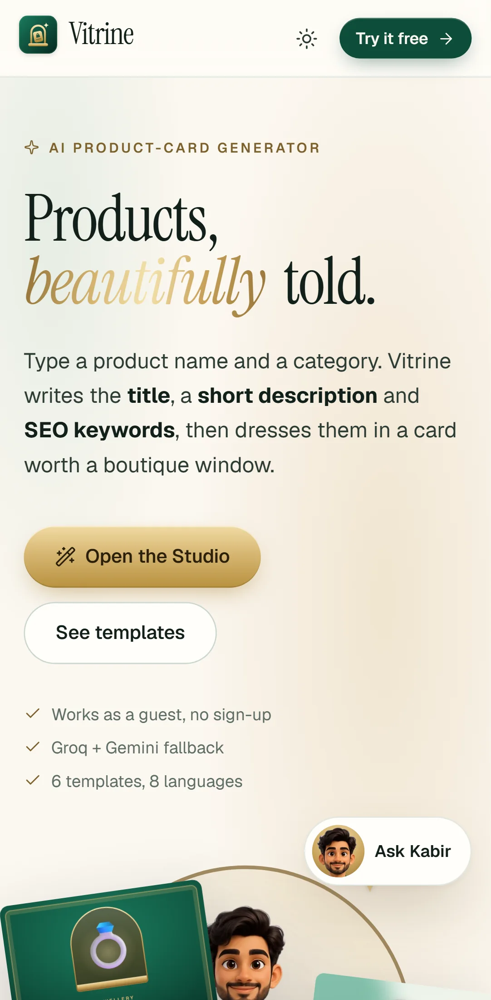
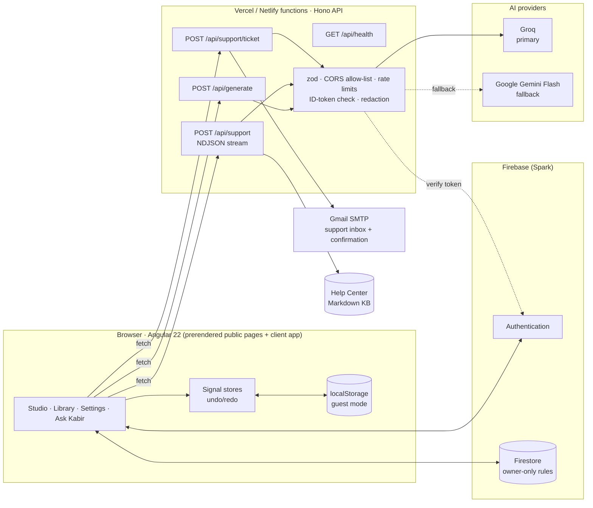

<div align="center">


# Vitrine

**Products, beautifully told.** An AI product-card generator built with Angular 22.<br/>
Type a product name and a category, get a **title, short description and SEO keywords**, and style them on six luxury card templates.

[](https://github.com/bapanghosh0812/vitrine-ai-product-cards/actions/workflows/ci.yml)


</div>

> ### Recruiter Quick Access
> | | |
> | --- | --- |
> | **Live app (Vercel)** | https://vitrine-ai-product-cards.vercel.app |
> | **Mirror (Netlify)** | https://vitrine-ai-product-cards.netlify.app |
> | **Mirror (GitHub Pages)** | https://bapanghosh0812.github.io/vitrine-ai-product-cards/ |
> | **Try it in 10 seconds** | Open the Studio. **No login needed**: guest mode runs the full generator and saves cards in your browser. |
> | **Accounts** | Sign up with email (with verification), Google, or a one-time email link to sync cards, Brand Kit and settings across devices. |
> | **Support** | Ask Kabir answers from the Help Center; "Talk to a human" emails the support team and sends you a branded confirmation with a ticket ID. |
> | **Documents** | Solution write-up and Test Report PDFs are attached to the submission email. |

---

## Contents
[Assignment checklist](#assignment-checklist) · [Features](#features) · [Screenshots](#screenshots) · [Architecture](#architecture) · [Quick start](#quick-start) · [Environment](#environment-variables) · [How AI is used](#how-ai-is-used) · [Design decisions](#design-decisions) · [Testing](#testing) · [Security](#security) · [Deployment](#deployment) · [Roadmap](#roadmap) · [Credits](#credits)

## Assignment checklist
| Requirement (INT. assignment 2) | Where it lives |
| --- | --- |
| Form with product name + category | `src/app/features/studio/generate-form.ts`, `category-picker.ts` (20 categories with 3D icons, validation, error messages) |
| "Generate Details" button | Gold button in the Studio; also `Ctrl/Cmd + Enter` |
| AI returns title, short description, keywords | `server/lib/ai.ts` (Groq → Gemini fallback), strict JSON validated with zod in `server/lib/schemas.ts` |
| Styled product card | `src/app/shared/card/product-card.ts` + `.css` (6 templates) |
| Simple state management | Signal store with undo/redo: `src/app/state/studio.store.ts` |
| Angular, CSS styling | Angular 22 (standalone, signals, zoneless), Tailwind CSS v4 + hand-written component CSS |
| AI via REST API | `POST /api/generate` (Hono) on Vercel Functions and Netlify Functions |
| README with design choices and AI usage | This file, plus `docs/adr/` |

## Features
- **Studio:** 1 or 3 variations, regenerate a single field, inline editing with SEO character counters, undo/redo, audience/tone/features/price/language options, 8 languages.
- **Six templates:** Minimal, Luxe Gold, Glass, Bold, Instagram post, Marketplace listing. Upload a photo (compressed in the browser) or use a 3D category icon.
- **Export:** PNG (1x/2x/3x), JSON, safe HTML snippet, copy text.
- **Library:** favourites, search and category filter. Guests save locally; accounts sync through Firestore.
- **Brand Kit:** brand name, voice, words to avoid and colours, injected into every prompt and used to tint templates.
- **Accounts:** email/password with verification and reset, Google sign-in, passwordless email-link sign-in, consent records with re-consent on new versions, guest-card import.
- **Ask Kabir:** a streaming support assistant grounded only in the in-repo Help Center, with sources, allow-listed action buttons and feedback.
- **Human support by email:** guests and signed-in users can open a ticket (name, email, optional phone, message, optional chat transcript). The ticket lands in the support inbox with Reply-To set to the customer, and the customer instantly receives an emerald-and-gold confirmation email with the logo, a greeting, the ticket ID and links back to the app. Rate limits per IP and per recipient, a honeypot, header-injection checks and verified-email rules stop the form being used to spam anyone.
- **Settings:** search plus ten sections (Account, Appearance, Brand Kit, Generation, Card & Export, History & Privacy, Notifications & Sound, Accessibility, Help, About).
- **Profile:** 16 avatars, stats and eight badges. An **owner inbox** page lists signed-in users' tickets (admin custom claim).
- **Polish:** light, dark (emerald-black), OLED and system themes, spring motion, View Transitions, skeletons, toasts, command palette (`Ctrl/Cmd + K`), keyboard shortcuts, PWA with offline page.
- **Legal pack:** 26-section Terms of Service (scroll-to-accept), Privacy Policy (DPDP Act 2023 + GDPR), Cookie Policy, AI Disclaimer, Acceptable Use Policy.

## Screenshots
> Captured from the production build with fixed sample copy (`npm run screenshots`) so the images are reproducible.

| Studio | Dark theme |
| --- | --- |
|  |  |
| **Landing** | **Templates** |
|  |  |
| **Ask Kabir** | **Scroll-to-accept Terms** |
|  |  |

<p align="center"> </p>

## Architecture

- **Frontend:** standalone components, signals, zoneless change detection, OnPush everywhere, lazy routes, `@defer` for the bot and overlays. Public pages (landing, help, legal, templates, studio) are prerendered to static HTML.
- **API:** one Hono app (`server/app.ts`) deployed as a Vercel Function (Build Output API, bundled with esbuild) and a Netlify Function. GitHub Pages serves the static build and calls the Vercel API.
- **Data:** Firebase Auth + Firestore (no Storage bucket: images are compressed to WebP in the browser and stored inside the card document, under 300 KB).

## Quick start
Requires **Node.js 24.15+** (`.nvmrc`).
```bash
npm ci
cp .env.example .env.local    # add GROQ_API_KEY / GEMINI_API_KEY, or set AI_MOCK=1 to run offline
npm run dev                   # API on http://localhost:8787, app on http://localhost:4200
```
Without Firebase values the app runs in guest mode only. Other useful scripts: `npm run build`, `npm test`, `npm run test:api`, `npm run e2e`, `npm run security:audit`.

## Environment variables
| Variable | Where | Purpose |
| --- | --- | --- |
| `GROQ_API_KEY`, `GEMINI_API_KEY` | Server only | AI providers (free tiers). Never shipped to the browser. |
| `GROQ_MODEL`, `GROQ_FALLBACK_MODEL`, `GEMINI_MODEL` | Server | Model IDs, configurable without code changes. |
| `FIREBASE_PROJECT_ID` | Server | Verifies Firebase ID tokens with public keys (no service account on servers). |
| `ALLOWED_ORIGINS` | Server | Extra CORS origins (same-host requests are always allowed). |
| `AI_BUDGET_MS`, `AI_MOCK` | Server | Time budget per AI request; deterministic offline mock for tests. |
| `SMTP_USER`, `SMTP_PASS` | Server only | Gmail account and app password that send support emails. |
| `SUPPORT_INBOX` | Server | Where new tickets are delivered (defaults to `SMTP_USER`). |
| `SITE_URL`, `MAIL_MOCK` | Server | Links and logo used in emails; `MAIL_MOCK=1` captures emails instead of sending (tests). |
| `OWNER_EMAIL` | Local script | Account that receives the `admin` claim (`scripts/set-admin-claim.mjs`). |
| `NG_APP_FIREBASE_*` | Build (public) | Firebase web config. Public by design; access is enforced by `firestore.rules`. |
| `NG_APP_API_BASE`, `NG_APP_SITE_URL`, `NG_APP_SUPPORT_EMAIL` | Build (public) | API origin for GitHub Pages, canonical URL, grievance contact. |

## How AI is used
**In the product**
- **What:** generating a product title (≤ 60 characters target), a 2–3 sentence description (≈ 140–220 characters) and 4–10 SEO keywords; regenerating one field; three variations; answering support questions in Ask Kabir.
- **Models:** Groq is the primary provider (`openai/gpt-oss-120b` by default, `openai/gpt-oss-20b` as a second Groq model) and Google **Gemini Flash** (`gemini-3.1-flash-lite` by default) is the automatic fallback. Model IDs are environment variables. The UI shows which provider answered.
- **Prompts:** a fixed system prompt defines copy rules (length, tone, plain text, no unverifiable claims). User input is serialised as JSON inside a `<product_data>` block and the model is told to treat it as data only (`server/lib/prompts.ts`). Brand Kit values and options are added as structured fields.
- **Validation:** the provider must return structured JSON (AI SDK `Output.object`); the server re-validates with zod, strips links, HTML, markdown, emails and control characters, fixes lengths on word boundaries, de-duplicates keywords, retries once and then falls back to the next provider within a time budget.
- **Safety:** AI output is rendered only as escaped text. Ask Kabir answers only from Help Center articles retrieved with BM25, can trigger only allow-listed actions, and every streamed byte passes a redaction filter that masks credentials and blocks system-prompt recitation (tested with an adversarial fake model in `server/security.spec.ts`).
- **Privacy:** product details and support questions are sent to Groq and Google; email addresses, account IDs and images are never sent. Free AI tiers may use inputs to improve their services, which the Privacy Policy and AI Disclaimer state clearly.
- **Limitations:** AI copy can be generic or wrong (materials, sizes, certifications), non-English output may be less fluent, and free-tier rate limits apply. Users are told to review copy before publishing.

**In the making of the project**
- The **Kabir mascot** and the **app-icon artwork** were created with AI image tools. The SVG logo, favicon and interface were designed and built by hand.

## Design decisions
Short records live in [`docs/adr/`](docs/adr):
[0001 static prerender](docs/adr/0001-static-prerender-and-hosting.md) ·
[0002 one Hono API on two hosts](docs/adr/0002-hono-api-on-vercel-and-netlify.md) ·
[0003 AI provider fallback](docs/adr/0003-ai-provider-fallback-and-validation.md) ·
[0004 rate limiting](docs/adr/0004-rate-limiting.md) ·
[0005 Firebase without Storage](docs/adr/0005-firebase-auth-firestore-no-storage.md) ·
[0006 security model](docs/adr/0006-security-model.md) ·
[0007 guest mode instead of a demo account](docs/adr/0007-guest-mode-no-demo-account.md)

Visual language: ivory `#FBF7F0`, deep emerald `#0E4D3A` and gold `#C9A35B`; Instrument Serif for display and Geist for UI; Microsoft Fluent Emoji 3D for categories and avatars; spring easing (`linear()` curves) and View Transitions, all disabled by "Reduce motion".

## Testing
All numbers below come from local runs on 18 November 2026 (see the Test Report PDF for details).

| Suite | Tool | Result |
| --- | --- | --- |
| API unit + security tests | Vitest (Node) | **55 / 55 passed** · coverage: 74.0% statements, 77.7% lines, 82.5% functions |
| Angular unit + component tests | Vitest (jsdom) via `ng test` | **34 / 34 passed** · coverage: 37.3% statements (UI flows are covered by e2e) |
| Firestore security rules | Firebase emulator + `@firebase/rules-unit-testing` | **15 / 15 passed** (IDOR with a second user, privilege escalation, validation) |
| End-to-end | Playwright (Chromium desktop + Pixel 7 emulation), AI and email mocked | **63 passed, 1 skipped** (a mobile-only test on desktop) |
| Accessibility | axe-core (WCAG 2.1 AA) inside e2e | **0 serious/critical violations** on 7 key pages |
| Lighthouse | Mobile and desktop, 4 pages | **Performance 95–98 mobile, 99–100 desktop · Accessibility, Best Practices and SEO 100 on every page** |
| Security self-attack | `scripts/security-audit.ts` | **13 / 13 rounds passed** after fixing 10 findings |
| Live AI | `scripts/live-check.mjs` with the real keys | Groq (`gpt-oss-120b`) answered in 1.3 s, Gemini (`gemini-3.1-flash-lite`) in 2.4 s; Ask Kabir on the live model: **0 leaks** across 6 prompts (4 jailbreak or extraction attempts, 1 off-topic request, 1 normal question) |
| Support email | Manual check with the real Gmail account | A ticket reached the support inbox and the branded confirmation reached the sender |

Firefox and WebKit projects run in CI on Linux; this Windows machine blocks Playwright's Firefox/WebKit binaries, so they were not run locally.

## Security
Keys stay on the server, `.env.local` is gitignored, secretlint runs as a pre-commit hook, and CI runs gitleaks, CodeQL, `npm audit` and Dependabot. Pages ship a hash-based Content Security Policy (no `unsafe-inline` scripts), `frame-ancestors 'none'`, HSTS and other headers. The API validates every request with zod, caps body size, enforces a CORS allow-list and per-IP/per-user rate limits, verifies Firebase ID tokens, and redacts bot output. Firestore rules are owner-only with field validation and no client-set roles. Details: [SECURITY.md](SECURITY.md) and [reports/security-report.md](reports/security-report.md).

## Deployment
- **CI/CD:** `.github/workflows/ci.yml` runs lint, typecheck, unit/API/rules/e2e tests, secret scans and the audit; its deploy jobs run only after CI passes and only when their tokens are set. Vercel and Netlify can also build straight from Git with the same build commands (`vercel.json`, `netlify.toml`).
- **Vercel:** `npm run build:vercel` produces `.vercel/output` (static files + an esbuild-bundled Node function). Needs repository secrets `VERCEL_TOKEN`, `VERCEL_ORG_ID`, `VERCEL_PROJECT_ID`; runtime secrets are set in the Vercel project. PRs get preview URLs posted as a comment.
- **Hosting env vars:** `node scripts/export-deploy-env.mjs` turns `.env.local` into gitignored `.env.vercel`, `.env.netlify` and `.env.github-variables` files to import in each dashboard, so keys never go through a command line.
- **Netlify:** `netlify.toml` builds the static site and bundles `netlify/functions/api.mts`. Needs `NETLIFY_AUTH_TOKEN`, `NETLIFY_SITE_ID`.
- **GitHub Pages:** built with base href `/vitrine-ai-product-cards/`, a `404.html` SPA fallback and the API pointed at Vercel.
- **Firebase:** project `vitrine-ai-cards` (Spark plan, Firestore in `asia-south1`). Rules and indexes are deployed; Email/Password, Email link and Google sign-in are enabled; the three hosting domains are in Authorized domains.

## Roadmap
- Bulk generation from a CSV and Shopify/WooCommerce export formats.
- A/B scoring of variations and readability hints.
- Shared team Brand Kits and Firestore-backed rate limits.
- More card templates and locale-aware price formatting.

## Credits
- **Designed & built by Bapan Ghosh** (Kolkata, India).
- 3D emoji: [Microsoft Fluent Emoji](https://github.com/microsoft/fluentui-emoji) (MIT). Fonts: Instrument Serif and Geist (SIL OFL 1.1). Icons: Lucide (ISC).
- Licensed under the [MIT License](LICENSE).
